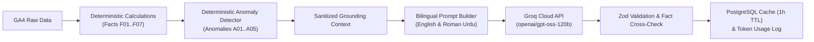

# Multi-Platform Marketing Analytics & AI Intelligence SaaS — AGENT.md

> **Living Project Blueprint & Agent Operational Guidelines**  
> *Last Updated: November 15, 2026*  
> *Repository: `waseemakram-dev/analytics-saas`*

---

## 1. Project Vision & Architecture

This SaaS platform is a modern, enterprise-grade **Multi-Platform Marketing Analytics & AI Intelligence Platform**. It connects marketing channels (Google Analytics 4, and future integrations for Google Ads, Google Search Console, YouTube Analytics, and Pinterest) into a unified workspace. It augments raw analytics with deterministic data calculations, anomaly detection, and generative AI intelligence powered by Groq (`openai/gpt-oss-120b`).

### Monorepo Structure

```text
analytics-saas/
├── apps/
│   ├── frontend/          # Next.js 16 App Router (Port 3000) - React 19, Tailwind CSS, Recharts, Lucide
│   └── backend/           # Next.js 16 API (Port 3001) - Auth.js v5, Prisma 7, PostgreSQL 18, Groq SDK
├── packages/
│   └── shared/            # Shared TypeScript contracts, validation schemas, and utilities
├── package.json           # Workspace root package manifest
└── agent.md               # Project development specification and active state (this file)
```

### Technology Stack
- **Frontend**: Next.js 16 (App Router), React 19, TypeScript, Tailwind CSS, Recharts, Lucide React, next-themes.
- **Backend API**: Next.js 16 App Router API routes, Node.js runtime, Argon2id, AES-256-GCM.
- **Database & ORM**: PostgreSQL 18, Prisma ORM 7 (`@prisma/adapter-pg`).
- **Authentication**: Auth.js v5 (NextAuth), Credentials provider + Google OAuth provider.
- **External APIs**: Google Analytics Admin API (v1alpha), Google Analytics Data API (v1beta), Groq Cloud API (`openai/gpt-oss-120b`).
- **Testing**: Vitest 3.x, real PostgreSQL test database (`analytics_saas_test`).

---

## 2. Professional Git & Granular Commit Policy (MANDATORY)

To maintain a professional GitHub profile with visible development progress and clean revision history:

### 1. Granular Atomic Commits Rule
**NEVER** bundle an entire multi-day stage or multiple distinct sub-features into one massive commit. Every distinct logical step must be committed individually:
- Database schema changes (`schema.prisma` + migrations/push) -> **Separate commit**.
- Business logic / calculations / anomaly detection -> **Separate commit**.
- AI provider integration / external APIs -> **Separate commit**.
- API route handlers and security guards -> **Separate commit**.
- Individual frontend components / pages -> **Separate commits**.
- Unit test suites -> **Separate commit**.
- Integration test suites -> **Separate commit**.
- Bug fixes / refactors -> **Separate commit**.
- Documentation -> **Separate commit**.

### 2. Conventional Commit Formatting
All commit messages must strictly follow the Conventional Commits specification:
- `feat(scope): ...` for new features or functionality.
- `fix(scope): ...` for bug fixes.
- `test(scope): ...` for adding or updating test suites.
- `refactor(scope): ...` for code adjustments without behavior changes.
- `docs(scope): ...` for documentation updates.
- `style(scope): ...` for formatting, UI tweaks, or CSS adjustments.
- `chore(scope): ...` for package updates, config changes, or toolchain scripts.

### 3. Pre-Commit Quality Checks
Before any commit is finalized:
1. `npm run test:backend` must pass 100%.
2. `npx tsc --noEmit` must yield 0 errors in both `apps/backend` and `apps/frontend`.
3. `npm run build:backend` and `npm run build:frontend` must succeed.
4. Git status must be checked to ensure **NO SECRETS** or `.env` files are staged.

---

## 3. Security, Privacy & Zero Secrets Guarantee

1. **Environment Variables**:
   - `GROQ_API_KEY`, `AUTH_SECRET`, `GOOGLE_CLIENT_SECRET`, and `ENCRYPTION_MASTER_KEY` are kept strictly in `apps/backend/.env`.
   - Never commit `.env` or `.env.local` files to Git.
   - Never print API keys in chat logs, console outputs, error messages, or markdown artifacts.
   - Placeholders only in `.env.example`.
2. **Encrypted Token Storage**:
   - All third-party OAuth access and refresh tokens are encrypted at rest using AES-256-GCM with versioned keys and initialization vectors.
3. **Multi-Tenant Workspace Isolation**:
   - Every database query and API request is verified against the authenticated user's workspace membership (`getUserActiveWorkspace`).
   - Cross-workspace data access is strictly blocked (`404 NOT_FOUND` or `403 FORBIDDEN`).
4. **Prompt Injection Sanitization**:
   - All untrusted text from external analytics accounts (page titles, paths, event names) is stripped of control characters, brackets, and markdown delimiters before being passed to AI prompts.

---

## 4. Feature Matrix & Implementation Status

| Feature / Module | Status | Backend Files | Frontend Files | Tests |
| :--- | :---: | :--- | :--- | :---: |
| **Authentication & Users** | ✅ COMPLETE | `src/server/auth/*`<br>`api/auth/*` | `src/app/(auth)/*`<br>`src/components/auth/*` | 27 tests |
| **Google Sign-In** | ✅ COMPLETE | `src/server/auth/authConfig.ts` | `src/components/auth/LoginForm.tsx` | Included |
| **GA4 OAuth & Property Management** | ✅ COMPLETE | `src/server/integrations/ga4/*`<br>`api/integrations/google/*` | `src/app/dashboard/websites/*`<br>`src/app/dashboard/integrations/*` | 31 tests |
| **GA4 Data Reporting & Caching** | ✅ COMPLETE | `src/server/integrations/ga4/services/ga4DataService.ts`<br>`api/analytics/*` | `src/lib/api/analyticsApi.ts` | 23 tests |
| **Analytics Dashboard Views** | ✅ COMPLETE | N/A (Consumes reporting APIs) | `src/app/dashboard/overview/*`<br>`traffic/*`, `pages/*`, `realtime/*` | Visual E2E |
| **Explain Every Metric** | ✅ COMPLETE | `packages/shared/src/metrics/*` | `src/components/analytics/MetricTooltip.tsx` | Verified |
| **Stage 4A: AI Insights Backend** | ✅ COMPLETE | `src/server/ai/*`<br>`api/ai/insights/route.ts` | N/A (Stage 4B) | 25 tests |
| **Stage 4B: AI Insights Frontend** | 🟡 READY | Ready to consume `POST /api/ai/insights` | `src/components/ai/*`<br>`src/app/dashboard/overview/*` | In Progress |
| **Stage 5: Ask AI Analytics Chat** | ⚪ PLANNED | Planned (`src/server/ai/chat/*`) | Planned (`src/components/ai/ChatDrawer.tsx`) | Pending |
| **Stage 6: Reports & Exports (PDF/CSV)** | ⚪ PLANNED | Planned (`src/server/reports/*`) | Planned (`src/components/reports/*`) | Pending |
| **Google Ads Integration** | ⚪ FUTURE | Planned | Planned | Pending |
| **Search Console Integration** | ⚪ FUTURE | Planned | Planned | Pending |
| **YouTube Analytics** | ⚪ FUTURE | Planned | Planned | Pending |
| **Pinterest Analytics** | ⚪ FUTURE | Planned | Planned | Pending |
| **Billing & Stripe Subscriptions** | ⚪ FUTURE | Planned | Planned | Pending |

---

## 5. Stage 4A: AI Intelligence Subsystem Details

The AI backend features a 5-layer pipeline:



### Core Architecture Components:
1. **Provider Abstraction** (`src/server/ai/providers/`):
   - `aiProvider.interface.ts`: Standard interface `IAiProvider`.
   - `groqProvider.ts`: Groq SDK client with 25s timeout and exponential backoff retry.
   - `aiProviderFactory.ts`: Resolves provider from `process.env.AI_PROVIDER`.
2. **Analysis & Grounding** (`src/server/ai/analysis/` & `grounding/`):
   - `metricsCalculator.ts`: Pre-calculates conversion rates, bounce rates, channel shares with immutable Fact IDs (`F01..F07`).
   - `anomalyDetector.ts`: Detects zero traffic, low volume, bounce spikes, and channel concentration risk with Anomaly IDs (`A01..A05`).
   - `analyticsContextBuilder.ts`: Gathers live GA4 data and sanitizes strings against prompt injection.
3. **Prompts & Validation** (`src/server/ai/prompts/` & `validators/`):
   - `insightsPrompt.ts`: Strict zero-hallucination prompts in English and Roman Urdu.
   - `insightsSchemas.ts`: Zod schema validating executive summary, health score, insights, and anomalies.
4. **Caching & Token Economics** (`src/server/ai/caching/`):
   - `aiInsightsCache.ts`: SHA-256 deterministic query hashing with 1-hour TTL.
   - `AiInsightCache` and `AiUsageLog` Prisma models.
5. **API Route** (`src/app/api/ai/insights/route.ts`):
   - Protected by Auth.js session authentication, workspace membership verification, property access verification, and workspace rate limiting (15 req/min).

---

## 6. Automated Test Suite (106 Passing Tests)

### Summary
- **Total Test Suites**: 20 files
- **Total Passing Tests**: 106 tests (0 failing, 0 skipped)
- **Execution Time**: ~9.9s

### Test Files Reference:
1. `tests/unit/password.test.ts` (5 tests) — Argon2id password hashing.
2. `tests/unit/tokens.test.ts` (4 tests) — Cryptographic tokens.
3. `tests/unit/validation.test.ts` (10 tests) — Input validation schemas.
4. `tests/unit/emailService.test.ts` (2 tests) — Email dispatch abstraction.
5. `tests/unit/rateLimiter.test.ts` (3 tests) — In-memory rate limiting.
6. `tests/unit/ga4Encryption.test.ts` (6 tests) — AES-256-GCM token encryption.
7. `tests/unit/ga4StateManager.test.ts` (4 tests) — OAuth state validation.
8. `tests/unit/ga4QueryHash.test.ts` (2 tests) — Analytics query hashing.
9. `tests/unit/ga4AdminAndDataServices.test.ts` (7 tests) — Google Analytics APIs.
10. `tests/unit/aiProvider.test.ts` (5 tests) — AI provider factory, Groq retry, error mapping.
11. `tests/unit/aiAnalysisAndGrounding.test.ts` (7 tests) — Metrics math, anomaly detection, prompt sanitization.
12. `tests/unit/aiPromptsAndValidation.test.ts` (4 tests) — Bilingual prompts and Zod validation.
13. `tests/integration/apiRoutes.test.ts` (9 tests) — Auth HTTP routes.
14. `tests/integration/authServices.test.ts` (10 tests) — Registration, verification, password reset.
15. `tests/integration/realDatabase.test.ts` (5 tests) — PostgreSQL atomic user and workspace transactions.
16. `tests/integration/ga4RealDatabase.test.ts` (6 tests) — Real PostgreSQL token encryption and property linkage.
17. `tests/integration/ga4ApiRoutes.test.ts` (8 tests) — GA4 reporting API routes and caching.
18. `tests/integration/aiInsightsApi.test.ts` (5 tests) — AI insights API route security, rate limits, and outputs.
19. `tests/integration/aiRealDatabase.test.ts` (3 tests) — Real PostgreSQL AI caching, token logs, and cascade deletes.
20. `tests/integration/groqLiveApi.test.ts` (1 test) — Live Groq cloud API connectivity and token bounds.

---

## 7. Next Roadmap: Stage 4B AI Frontend

With Stage 4A backend fully verified, Stage 4B will implement:
1. **AI Insights Overview Card** (`src/components/ai/AiInsightsCard.tsx`):
   - Health score gauge (0-100).
   - Executive summary paragraph.
   - Categorized insight items with impact badges (Positive, Negative, Neutral).
2. **Bilingual Toggle**:
   - Instant toggle between English (`en`) and Roman Urdu (`roman-ur`).
3. **On-Demand Refresh**:
   - "Refresh Insights" button with loading skeletons to invoke `refresh=true`.
4. **Actionable Recommendations Drawer**:
   - Detailed marketing next steps with fact citations.
5. **Granular Commits**:
   - UI components, bilingual switcher, hooks, and integration committed in separate atomic commits.
